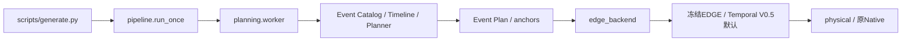
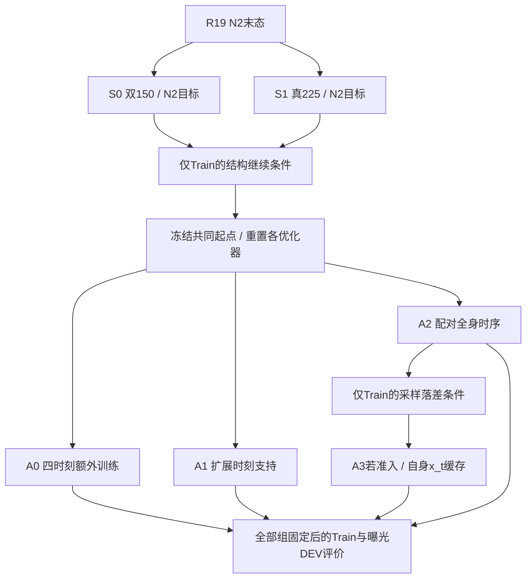
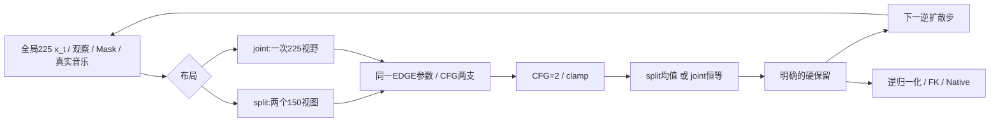

# 默认调用与R20研究调用

本图对应本仓库实现。复用加载器/数据/坐标/FK，不代表串联二十个生成网络。

## 默认生成

来源：src/dunhuang/pipeline.py、planning/worker.py、edge_backend.py、physical.py。
研究训练权重不因本轮结果自动替换configs/default或运行资产。

## R20实验组织

各分支是独立训练对照，不是一次前向串联的模型。
temporal_r20/common.py复用R19/R18/R17加载器和资产血缘；实际主干仍是一份EDGE。

## 每个去噪步骤

Joint仅对null_cond_embed作固定长度适配，已有音乐编码器权重保持。
两个布局都是INBETWEEN可靠双端研究；整曲右端动作Root并非天然真值。
R20不运行生成历史训练，也不把缓存x_t叫已生成舞蹈历史。
